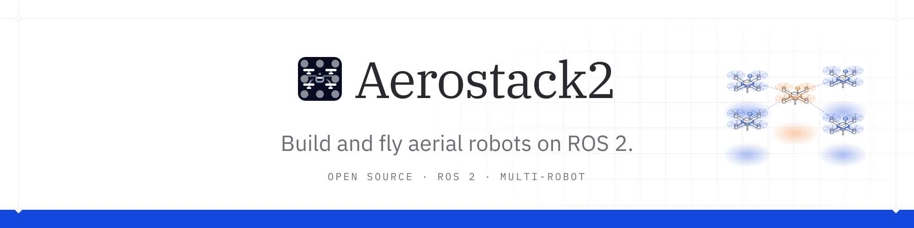

<p align="center">
  <a href="https://aerostack2.org">
    <picture>
      <source media="(prefers-color-scheme: dark)" srcset=".github/assets/banner-dark.png">
      
    </picture>
  </a>
</p>

<p align="center">
  <a href="https://github.com/aerostack2/aerostack2.dev/actions/workflows/ci.yml"></a>
  <a href="https://nextjs.org"></a>
  <a href="https://fumadocs.dev"></a>
  <a href="https://bun.sh"></a>
</p>

<p align="center">
  <a href="https://aerostack2.org">Website</a> ·
  <a href="https://aerostack2.org/docs">Docs</a> ·
  <a href="https://github.com/aerostack2/aerostack2">Aerostack2</a> ·
  <a href="https://github.com/aerostack2/aerostack2.dev/issues">Issues</a>
</p>

The website and documentation of [Aerostack2](https://github.com/aerostack2/aerostack2), an open
source framework for developing multi-robot aerial systems, built on ROS 2.

- **Docs in MDX.** Every page lives in `content/docs`, with components for diagrams, figures and file trees.
- **Versioned.** Each minor release keeps a frozen copy of its docs, with its own sidebar and search.
- **LLM friendly.** The site serves `/llms.txt`, `/llms-full.txt` and a Markdown version of every page.

It's a [Next.js](https://nextjs.org) app built with [Fumadocs](https://fumadocs.dev), deployed on
Vercel.

## Running it

```bash
bun install
bun dev
```

Then open http://localhost:3000.

| Command | What it does |
| --- | --- |
| `bun dev` | Starts the dev server |
| `bun run build` | Builds the site for production |
| `bun start` | Serves the production build |
| `bun run types:check` | Checks the types |
| `bun run lint` | Lints and checks formatting with Biome |
| `bun run docs:cut <version>` | Freezes the main docs as a release, see [Versions](#versions) |
| `bun run changelog` | Writes `CHANGELOG.md` from the commit history with git-cliff |

## Versions

The docs for `main` live in `content/docs` and are served at `/docs`. Each minor release is a frozen copy in `content/docs/<major.minor>`, served at `/docs/<major.minor>` with its own sidebar and search. Patch releases share their minor's docs.

| When | What to do |
| --- | --- |
| A minor or major release (2.1) | Run `bun run docs:cut 2.1`, set `upcomingDocsVersion` in `src/lib/shared.ts` to the next release, or to `null` if none is planned, and open a PR |
| A patch release (2.1.1) | Nothing, unless the patch changes something the docs cover. Then edit `content/docs/2.1` directly, and `content/docs` too when the change also applies to `main` |
| A fix to a release's docs | Edit its folder directly. Never copy pages from `main` again, since `main` may already document the next release |

The `docs:cut` script copies the main docs into `content/docs/<major.minor>`, points their absolute links at `/docs/<major.minor>` and gives the folder its own sidebar. It refuses anything but `major.minor` and an existing folder.

Links added to a release's pages by hand must start with `/docs/<major.minor>/`, or they lead to `main`. Relative links work in every folder.

The version selector lists `main`, `upcomingDocsVersion` as coming soon until its folder exists, and each release folder. A release's patch number is its newest tag on [aerostack2](https://github.com/aerostack2/aerostack2), refreshed once a day like the GitHub stats.

## Deployment

The site is hosted on Vercel as a standard Next.js app. Images are served without Vercel's image optimization, which keeps the site clear of its image quotas.

> [!NOTE]
> The Vercel project currently lives in the personal account of [alvgaona](https://github.com/alvgaona), not in an Aerostack2 team.

### Environment variables

In production, set both variables in the Vercel project's settings. Locally they're optional, and you can put them in `.env.local`, which git ignores.

| Variable | What it's for |
| --- | --- |
| `GITHUB_TOKEN` | The star and fork counts and the contributors, which take about fifty requests to the GitHub API. Without a token GitHub rate-limits them. Setting it to `$(gh auth token)` works locally |
| `SERPAPI_API_KEY` | The citation count and the list of citing papers, from Google Scholar through [SerpApi](https://serpapi.com). Without it the count falls back to the last known one and the list links to Google Scholar |

GitHub data refreshes once a day and citations once a month, in production and in dev.

## Layout

| Path | What's there |
| --- | --- |
| `content/docs` | The documentation pages, in MDX |
| `src/app/(home)` | The home page |
| `src/app/docs` | The documentation layout and pages |
| `src/components` | Components, including the ones the MDX pages use, registered in `mdx.tsx` |
| `src/lib` | The content source, shared settings and the GitHub and citation data |
| `public` | Images and other static files |

## Contributing

Contributions are welcome. Read [CONTRIBUTING.md](CONTRIBUTING.md), then open an [issue](https://github.com/aerostack2/aerostack2.dev/issues) or a pull request. New pages and features start with an issue, not a pull request.
